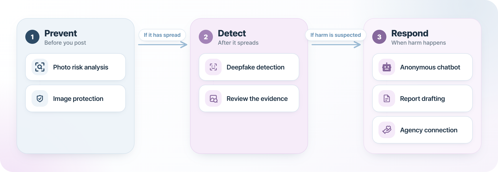
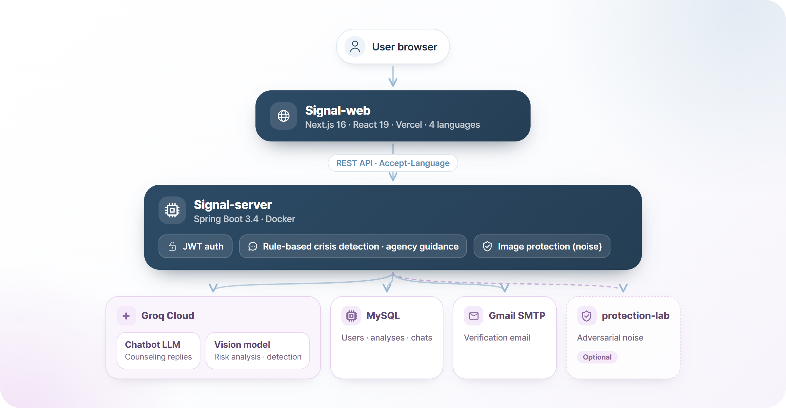

  

  <a href="https://github.com/somaus">한국어</a> | <b>English</b>

<h3 align="center">AI-powered deepfake harm prevention, detection & response</h3>

  <a href="https://signal-web-rho.vercel.app"><b>Visit Signal</b></a>
  &nbsp;·&nbsp;
  <a href="https://github.com/somaus/Signal-web">Web</a>
  &nbsp;·&nbsp;
  <a href="https://github.com/somaus/Signal-server">Server</a>

 

## Why Signal?

Generative AI now makes it easy for anyone to create deepfake images and videos using someone else's face. Sexual crimes, defamation, and fraud that exploit deepfakes are rising fast. Yet most people don't realize their photos can be misused, and even after harm occurs, many miss the chance to respond because they don't know where to turn.

**Signal** is a one-stop service that guides you through **prevention** before you post a photo, **detection** of photos that have already spread, and **response** when harm happens.

## Key features

| Stage | Feature | Description |
| :---: | --- | --- |
| **Prevent** | Photo risk analysis | Before you post on social media, AI checks face exposure, image quality, metadata, and reverse-search risk. |
| | Image protection | Adds noise to your photo to make unauthorized use harder. |
| **Detect** | Face theft & deepfake detection | Analyzes signs of synthesis in a photo and shows the reasoning behind the result. |
| **Respond** | Anonymous chatbot | Talk with AI without revealing who you are, and get guidance on what to do next. |
| | Report support | Enter what you remember, and Signal drafts a report document ready to submit to agencies. |
| | Agency connection | Finds and connects you to counseling and reporting agencies that fit your situation. |

You can try analysis, detection, and chat without logging in. Log in to save your records.

### Service flow

  

## Multilingual support

Foreign residents in Korea can face the same harm, so both the interface and AI responses support **한국어 · English · 日本語 · 简体中文**.

## Repositories

| Repository | Description |
| --- | --- |
| [**Signal-web**](https://github.com/somaus/Signal-web) | Responsive web frontend |
| [**Signal-server**](https://github.com/somaus/Signal-server) | API server & AI integration |

## Tech stack

| Area | Technologies |
| --- | --- |
| **Frontend** | Next.js 16 (App Router) · React 19 · TypeScript · Tailwind CSS v4 · TanStack Query |
| **Backend** | Spring Boot 3.4 · Java 21 · Spring Security + JWT · MySQL |
| **AI** | Groq-hosted LLM (counseling chatbot) · Qwen-family vision model (risk analysis & deepfake detection) |
| **Infra** | Vercel (Web) · Docker (Server) |

### System architecture

  

> AI analysis and detection results come from general-purpose AI models and are provided as **reference indicators**, not definitive judgments. Crisis detection and agency guidance are handled by rule-based logic, not AI.

## Team

<table>
  <tr>
    <td align="center"><a href="https://github.com/ryusuye0n"> <b>Suyeon Ryu</b></a></td>
    <td align="center"><a href="https://github.com/hyooeunn"> <b>Hyoeun Lee</b></a></td>
    <td align="center"><a href="https://github.com/jyx-07"> <b>jyx-07</b></a></td>
    <td align="center"><a href="https://github.com/hyeinggu"> <b>hyeinggu</b></a></td>
  </tr>
</table>

 

Soma + Us. Building things together.

