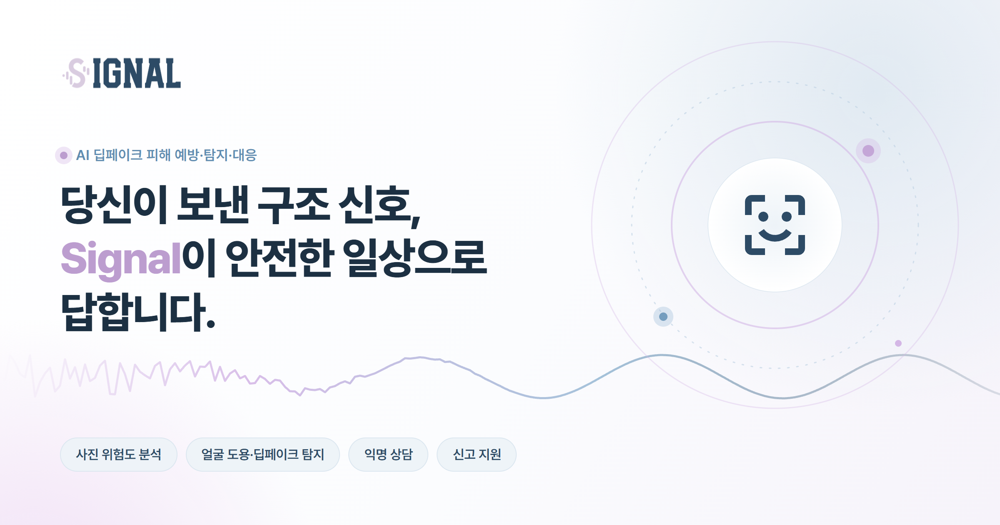
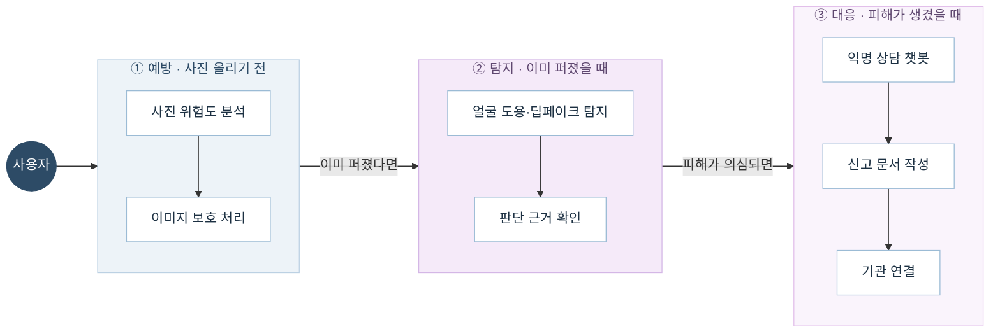
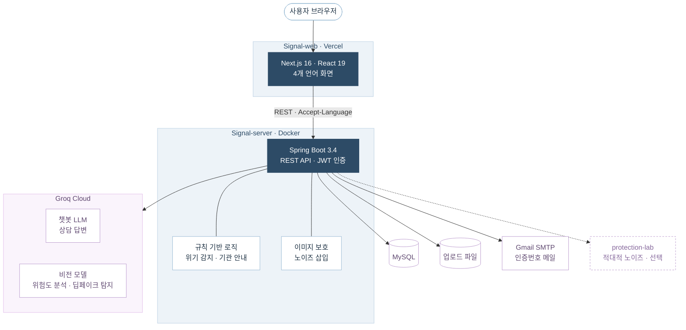

  

  <b>한국어</b> | <a href="https://github.com/somaus/.github/blob/main/profile/README.en.md">English</a>

<h3 align="center">AI 기반 딥페이크 피해 예방·탐지·대응 서비스</h3>

  <a href="https://signal-web-rho.vercel.app"><b>서비스 바로가기</b></a>
  &nbsp;·&nbsp;
  <a href="https://github.com/somaus/Signal-web">Web</a>
  &nbsp;·&nbsp;
  <a href="https://github.com/somaus/Signal-server">Server</a>

 

## 왜 Signal인가요?

생성형 AI가 발전하면서 누구나 손쉽게 타인의 얼굴을 합성한 딥페이크 이미지·영상을 만들 수 있게 되었습니다. 딥페이크를 악용한 성범죄·명예훼손·사기 피해는 빠르게 늘고 있지만, 대부분의 사람은 자신의 사진이 악용될 수 있다는 사실을 모르고, 피해를 입은 뒤에도 어디에 알려야 할지 몰라 대응 시점을 놓칩니다.

**Signal**은 사진을 올리기 전의 **예방**, 이미 퍼진 사진의 **탐지**, 피해가 생겼을 때의 **대응**까지 하나의 흐름으로 돕는 원스톱 서비스입니다.

## 주요 기능

| 단계 | 기능 | 설명 |
| :---: | --- | --- |
| **예방** | 사진 위험도 분석 | SNS에 올리기 전, AI가 얼굴 노출도·이미지 품질·메타데이터·역검색 위험을 진단합니다. |
| | 이미지 보호 처리 | 사진에 노이즈를 넣어 무단 활용을 어렵게 합니다. |
| **탐지** | 얼굴 도용·딥페이크 탐지 | 사진의 합성 흔적을 분석하고 판단 근거를 함께 보여줍니다. |
| **대응** | 익명 상담 챗봇 | 신원을 밝히지 않고 AI와 상담하며 다음 행동을 안내받습니다. |
| | 신고 지원 | 기억나는 내용만 입력하면 기관에 제출하기 좋은 신고 문서 초안을 만들어 줍니다. |
| | 기관 연결 | 피해 상황에 맞는 상담·신고 기관을 찾아 바로 연결합니다. |

로그인 없이도 분석·탐지·상담을 체험할 수 있고, 기록을 저장하려면 로그인합니다.

### 서비스 흐름

## 다국어 지원

국내에 거주하는 외국인도 같은 피해를 겪을 수 있기에, 화면과 AI 응답 모두 **한국어 · English · 日本語 · 简体中文**을 지원합니다.

## 저장소

| 저장소 | 설명 |
| --- | --- |
| [**Signal-web**](https://github.com/somaus/Signal-web) | 반응형 웹 프론트엔드 |
| [**Signal-server**](https://github.com/somaus/Signal-server) | API 서버 · AI 연동 |

## 기술 스택

| 구분 | 사용 기술 |
| --- | --- |
| **Frontend** | Next.js 16 (App Router) · React 19 · TypeScript · Tailwind CSS v4 · TanStack Query |
| **Backend** | Spring Boot 3.4 · Java 21 · Spring Security + JWT · MySQL |
| **AI** | Groq 호스팅 LLM (상담 챗봇) · Qwen 계열 비전 모델 (위험도 분석·딥페이크 탐지) |
| **Infra** | Vercel (Web) · Docker (Server) |

### 시스템 구조

> AI 분석·탐지 결과는 범용 AI 모델의 판단으로, 확정 판정이 아닌 **참고 지표**로 제공합니다. 위기 감지와 기관 안내는 AI가 아닌 규칙 기반 로직이 담당합니다.

## Team

<table>
  <tr>
    <td align="center"><a href="https://github.com/ryusuye0n"> <b>류수연</b></a></td>
    <td align="center"><a href="https://github.com/hyooeunn"> <b>이효은</b></a></td>
    <td align="center"><a href="https://github.com/jyx-07"> <b>종윤</b></a></td>
    <td align="center"><a href="https://github.com/hyeinggu"> <b>hyeinggu</b></a></td>
  </tr>
</table>

 

Soma + Us. Building things together.

